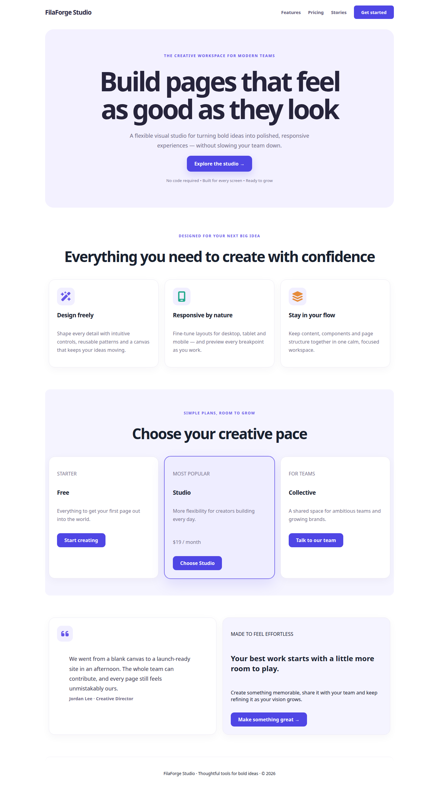
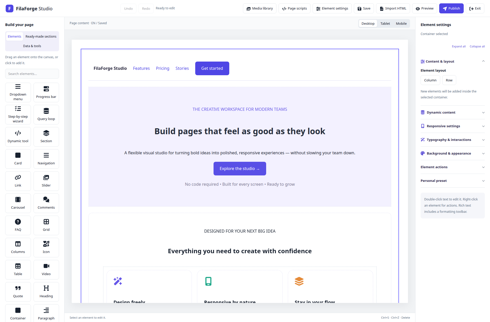

# FilaForge Studio

**A visual page builder for Laravel 12 and 13 with Filament 5, with Persian and RTL authoring built in.** Create responsive pages in a Filament panel, then render published revisions as server-generated HTML in a Laravel site.

FilaForge stores pages as validated, versioned JSON documents. The editor and public renderer are separate: public pages do not load the editor runtime, and the host application keeps control of routes, authorization, tenants, and caching.

[Composer package](https://packagist.org/packages/filaforge-studio/filaforge-studio) · [GitHub repository](https://github.com/dehnavi/filaforge-studio) · [Installation guide](docs/installation.md) · [Security guide](docs/security.md)

## Preview

An English sample page rendered by FilaForge Studio:



The page open in the Filament editor:



## What you can build

- **Visual authoring:** isolated canvas, drag and drop, nested layouts, layers, inline rich text, undo and redo, responsive settings, and preview.
- **Page building blocks:** 32 built-in widget types and 18 presets for layouts, content, media, navigation, FAQs, testimonials, pricing, carousels, wizards, and more.
- **Persian and RTL:** 17 interface locale catalogs, page language and direction, mixed RTL/LTR content, and configurable fonts.
- **Media library:** Laravel Filesystem uploads, stable media references, folders, categories, metadata, image editing, and remote image/video references.
- **Dynamic content:** explicitly registered providers, field and filter allowlists, bounded query loops, conditional display, and controlled shortcode-to-widget conversion.
- **Publishing:** versioned documents, draft and published revisions, optimistic concurrency checks, atomic publication, and draft restoration from publication history.
- **Server rendering:** HTML fragments for an existing layout, complete HTML documents, Laravel responses, or the exact published revision for a page locale.
- **Reusable content:** independent published sections, linked shared sections, sanitized HTML blocks, database card repeaters, and typed shared styles.
- **Editing workflow:** optional client locks and exposed fields, autosave, tab-local recovery, and publication history with draft restore.
- **Extensibility:** trusted custom widgets with Filament inspectors, presets, fonts, and Laravel data providers.

See [reusable sections and database repeaters](docs/reusable-sections.md), [widgets and presets](docs/widgets-and-presets.md), [media and fonts](docs/media-and-fonts.md), [dynamic content](docs/dynamic-content.md), and [current capabilities and limitations](docs/limitations.md) for details.

## Requirements

- PHP 8.2 or newer
- Laravel 12 or 13 (Laravel 13 requires PHP 8.3+)
- Filament 5 and its compatible Livewire version
- PHP extensions: DOM, Fileinfo, GD, and mbstring
- A database driver supported by the host Laravel application
- `pdo_sqlite` to run the package test suite
- Optional `intl` for Persian calendar date formatting

## Install and register Filament

```sh
composer require filaforge-studio/filaforge-studio
php artisan filaforge:install
php artisan migrate
```

Register the plugin on each panel where editors should manage pages:

```php
use FilaForge\Studio\Filament\FilaForgeStudioPlugin;
use Filament\Panel;

public function panel(Panel $panel): Panel
{
    return $panel->plugin(FilaForgeStudioPlugin::make());
}
```

Package discovery registers the service provider. The plugin is opt-in per panel. Configure host authorization before editors create, update, publish, or moderate content. FilaForge does not create public website routes; your Laravel app owns page lookup and access rules. Follow the [installation guide](docs/installation.md) and [security guide](docs/security.md).

## Render a published page in Laravel

After creating a page in the Filament **Pages** resource and publishing it, resolve the locale and slug in a host-owned route. Scope the query to your tenant and visibility rules where applicable:

```php
use FilaForge\Studio\Models\PageLocale;
use FilaForge\Studio\Rendering\HtmlRenderer;
use Illuminate\Support\Facades\Route;

Route::get('/{locale}/{slug}', function (string $locale, string $slug, HtmlRenderer $renderer) {
    $page = PageLocale::query()
        ->where('locale', $locale)
        ->where('slug', $slug)
        ->firstOrFail();

    // Add tenant, visibility, and access constraints to this lookup as needed.
    return $renderer->publishedResponse($page);
});
```

`publishedResponse()` reads the locale's exact published revision, returns 404 when none exists, and never falls back to its draft. The default response uses private/no-store cache headers. The host remains responsible for route authorization and any tenant-aware caching policy.

## Embed a reusable section anywhere

Use a host-authorized `PageLocale` to insert its published content into any Blade view, without requiring a FilaForge layout:

```blade
<header>Your existing header</header>
{{ filaforge_section($authorizedPageLocale) }}
<footer>Your existing footer</footer>
```

Each instance receives isolated IDs and local anchor links. Register shared-section aliases to reuse published content inside other documents, optionally exposing selected text or image properties per instance. The visual database repeater builder creates editable cards from trusted provider fields, with sorting, filters and pagination. See [reusable sections and database repeaters](docs/reusable-sections.md) for examples, authorization, tokens, HTML sanitization, recovery and custom inspectors.

## Rendering helpers

Laravel package discovery loads three global helpers. Each accepts a validated FilaForge document; the optional page locale supplies page context for media, comments, and dynamic rendering.

### Put a fragment in an existing Blade layout

Use `filaforge_html()` when your application already owns the document shell and SEO metadata:

```blade
<main>
    {{ filaforge_html($pageLocale->publishedRevision->document, $pageLocale) }}
</main>
```

It returns an `HtmlString` containing rendered page markup and required styles/interactions. It does not compile stored content as Blade or include the editor runtime.

### Build a full document or HTTP response

`filaforge_document()` returns a complete HTML document. `filaforge_response()` wraps it in a Laravel response. `HtmlOptions` lets the host supply document metadata and stylesheets:

```php
use FilaForge\Studio\Rendering\HtmlOptions;

$document = $pageLocale->publishedRevision->document;
$options = new HtmlOptions(
    title: $pageLocale->title,
    description: 'Explore our services.',
    canonical: route('pages.show', [
        'locale' => $pageLocale->locale,
        'slug' => $pageLocale->slug,
    ]),
    stylesheets: ['/css/site.css'],
);

$html = filaforge_document($document, $options, $pageLocale);
return filaforge_response($document, $options, $pageLocale);
```

Canonical and stylesheet URLs must be HTTP(S) or root-relative. Page scripts stay off for these helpers unless explicitly enabled through `HtmlOptions` and allowed by host policy and CSP.

### Use the renderer service or facade

For dependency injection, use `HtmlRenderer`; the `StudioHtml` facade exposes its fragment and document methods:

```php
use FilaForge\Studio\Facades\StudioHtml;
use FilaForge\Studio\Rendering\HtmlRenderer;

$fragment = app(HtmlRenderer::class)->fragment($document, $pageLocale);
$html = StudioHtml::document($document, $options, $pageLocale);
```

### Embed a published page in a custom Filament view

The Filament plugin provides page editing. If a host Filament page or widget also needs to display a published page, resolve and authorize its `PageLocale` in the host component, then render its view with the helper:

```blade
{{-- resources/views/filament/pages/site-preview.blade.php --}}
<x-filament::section>
    <main>
        {{ filaforge_html($pageLocale->publishedRevision->document, $pageLocale) }}
    </main>
</x-filament::section>
```

Here `$pageLocale` must be the authorized locale model supplied by the host Filament page or widget. Keep tenant scoping and access checks in that component; a hidden panel action or URL slug is not authorization.

## Create and publish content

1. Define page-management abilities in the host application.
2. Open **Pages** in the selected Filament panel and create a page with its language and direction.
3. Add a section or container, then drag widgets or presets onto the canvas.
4. Edit content, typography, colors, background, and responsive settings.
5. Preview, save a draft, and publish when ready.
6. Render the published revision from a host-owned Laravel route or Blade view.

See the [quick start](docs/quick-start.md), [HTML output API](docs/html-output.md), and [SEO guide](docs/seo.md) for more examples.

## Development

```sh
composer install
vendor/bin/phpunit -c phpunit.xml
```

The package suite uses SQLite and covers validation, rendering, Filament integration, permissions, media, dynamic data, scripts, comments, and localization. For contributor workflow and documentation commands, see [CONTRIBUTING.md](CONTRIBUTING.md); for test evidence and remaining gaps, see [verification and limitations](docs/limitations.md).

## Contributing and security

Read [CONTRIBUTING.md](CONTRIBUTING.md) before making changes. Report vulnerabilities privately using the instructions in [SECURITY.md](SECURITY.md).

## License

FilaForge Studio is distributed under the [MIT License](LICENSE). Third-party assets may have separate terms; see their bundled notices.
